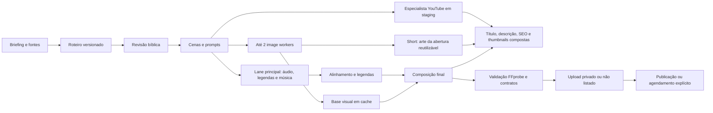

# Arquitetura e contratos

## Decisão principal

O núcleo usa Python 3.12, Pydantic, Typer e FFmpeg. Cada vídeo é uma unidade autocontida; não há
banco de dados global. Essa escolha reduz infraestrutura, torna o estado legível e permite adicionar
uma API/UI depois sem reescrever regras de negócio.

A única coordenação global é `content-registry.json`, mantido em uma branch de um repositório Git
bare compartilhado. Ele indexa reservas e usos de passagens/temas, mas não substitui as pastas dos
projetos como fonte de verdade. Local e VPS fazem push fast-forward: em concorrência, o push
rejeitado recarrega o JSON e repete a seleção antes de criar o projeto. Indisponibilidade bloqueia a
seleção em vez de usar um cache local possivelmente divergente.

## Estado e idempotência

`project.json` contém um `StageRecord` por etapa:

- `status`: pending, ready, running, waiting_approval, waiting_external, completed, failed, stale;
- `input_hash`: SHA-256 de entradas e configuração;
- `artifacts`: caminhos relativos esperados;
- `attempts`, provider, uso, erro e observação.

Uma etapa é reutilizada somente se o hash coincidir e todos os artefatos declarados existirem. O
flag `--force` ignora o cache, mas adaptadores versionados criam um novo candidato em vez de apagar o
aprovado.

## Aprovações

As aprovações ficam separadas do estado técnico. Um arquivo pode existir e ainda não estar aprovado.
Os checkpoints atuais são briefing, roteiro, revisão bíblica, imagens, metadados e render final.

O roteiro só é aprovado após uma revisão correspondente à mesma versão e sem bloqueio aberto. O
render real exige roteiro, revisão e imagens aprovados.

Em `draft_one_shot`, os mesmos bloqueios de consistência bíblica continuam valendo, mas as aprovações
humanas intermediárias não impedem `render/draft-preview.mp4`. A prévia usa versões ativas, fica em
cache separado e não toca o render final. O modo `guided` mantém os checkpoints tradicionais.

## Contratos de conteúdo

- `Briefing`: passagem, tema, aplicação, público, emoção, duração, tradução e limites.
- `SourceLibrary`: tipo, escopo da afirmação, fonte, acesso, verificação e direitos.
- `ScriptDocument`: seções narrativas, base bíblica e classificação das afirmações.
- `CreativeContract`: promessa, gancho, payoff, valor de cada seção, componentes críticos e perfil
  determinístico de ritmo, derivados sem chamada externa.
- `BiblicalReview`: findings com severidade, evidência, resolução e aprovação.
- `SceneManifest`: narração, tempo, emoção, ambiente, enquadramento, função e prompt modular.
- `ImageManifest`: prompt/hash, versões, candidato ativo e versão aprovada.
- `AudioManifest`: segmentos, provider, uso e timestamps globais por palavra.
- `CaptionManifest`: blocos, índices cobertos, caminhos e validação.
- `YouTubeMetadata`: rascunho, alternativas, capítulos e visibilidade segura.
- `YouTubeGrowthPackage`: handoff imutável do subagente, vinculado ao hash da fila.
- `YouTubeGrowthStrategy`: intenção de busca, palavras-chave, promessa, hipóteses e fontes oficiais.
- `ExperimentMemory`: hipótese, mudança, vídeos, período, métricas e conclusão cautelosa.
- `YouTubePublicationRecord`: ID remoto, canal, visibilidade e hashes dos ativos enviados.

## Render

1. O áudio define a timeline real.
2. Cada cena vira um segmento CFR com `scale`, `crop`, `zoompan` e fades discretos; até dois
   segmentos independentes podem ser processados em paralelo.
3. Os segmentos formam `render/work/base.mp4`, sem legenda e reutilizável. Bases de draft/final com
   o mesmo hash são compartilhadas por cópia atômica.
4. O ASS é aplicado à base junto da narração.
5. O final usa H.264/yuv420p, AAC e faststart; a prévia é derivada dele ou copiada sem recodificação
   quando os parâmetros são equivalentes.
6. FFprobe valida proporção, codecs, faixas, frame rate e duração.

O ASS emite um evento por intervalo de palavra, mas mantém o bloco inteiro no mesmo lugar; só a cor
do termo ativo muda. A mudança de cena não interfere na timeline da legenda.

## Fronteiras de extensão

- `images.py`: fixture e handoff Codex; pode receber outro adapter autorizado.
- `audio.py`: mock para testes e ElevenLabs para produção.
- `render.py`: FFmpeg; uma futura implementação pode obedecer aos mesmos manifests.
- `growth.py`: fila, staging e importação serial do especialista de crescimento do YouTube.
- `publication.py`: OAuth, upload retomável e publicação YouTube; consome apenas artefatos aprovados.
- UI/API: deverá orquestrar as mesmas funções, nunca reinterpretar estado por conta própria.

## Handoffs econômicos

Os especialistas recebem contextos derivados e compactos, mas a importação continua validando o
pacote contra os modelos Pydantic completos e os arquivos-fonte do projeto:

- `script/shorts-context.json` reúne briefing, fontes, decisões recentes e versões anteriores;
- `youtube/growth-context.json` reúne contrato criativo, outline, revisão compacta, abertura visual e
  no máximo seis experimentos relevantes, sem repetir locução ou prompt montado;
- `images/jobs/image-worker-N.json` entrega a cada trabalhador somente seus próprios jobs e prompts;
- os JSON Schemas enviados às filas removem somente metadados de apresentação, preservando tipos,
  enums, referências e campos obrigatórios;
- os subagentes partem com `fork_turns=none`, evitando herdar o histórico inteiro da conversa;
- em projetos novos, inclusive Shorts, a fila declara três bitmaps finais de thumbnail; o
  especialista incorpora texto e símbolos com imagegen e o importador não cria overlays locais;
- reutilização de cena e composição Pillow permanecem apenas como compatibilidade para projetos
  legados. Em Shorts, a primeira candidata integrada é usada no frame zero.

## Autopilot retomável

`pipeline-videos autopilot <projeto>` executa todas as etapas determinísticas e serializadas que
estiverem prontas. Quando encontra geração embutida pendente, grava o checkpoint em
`logs/autopilot-state.json`, informa exatamente quais arquivos de staging faltam e termina sem
perder o progresso. Depois do preenchimento pelos trabalhadores, uma nova execução faz uma única
importação em lote e continua até a prévia ou o próximo bloqueio.

O comando nunca cria duas escritas concorrentes no estado. A geração de imagens continua fora do
processo Python porque a ferramenta embutida pertence à sessão do Codex; áudio, música, legendas,
composição, validação e retomada são automatizados localmente.
